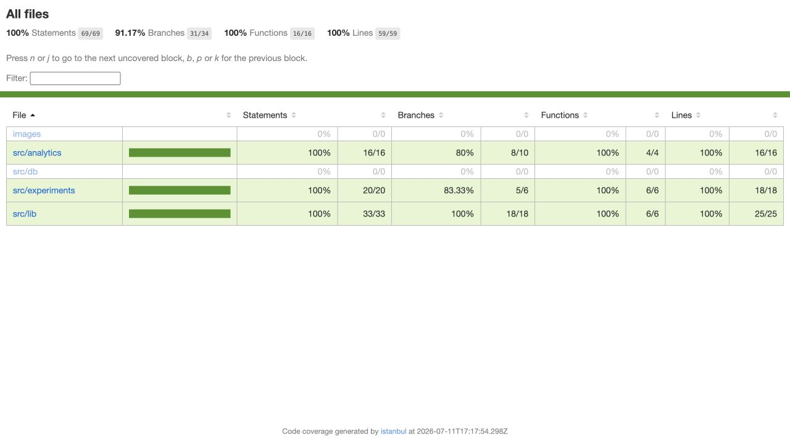

# PROOF OF CONCEPT A/B TESTING

## Development

This project uses Node.js 24 LTS and pnpm 11. The exact development versions are
pinned in the `packageManager` field in `package.json`.

Install dependencies with:

```sh
pnpm install
```

In the project directory, you can then run:

- `pnpm dev` - Start the Vite development server
- `pnpm build` - Build the production site in `dist`
- `pnpm typecheck` - Check the strict TypeScript project without emitting files
- `pnpm preview` - Preview the production build
- `pnpm test` - Run the Vitest suite once
- `pnpm test:coverage` - Run the suite and generate a coverage report
- `pnpm test:watch` - Run Vitest in watch mode

## Live

The application is deployed -> [https://abtest.surge.sh/](https://abtest.surge.sh/)

## Description

The idea of this project is to create a vanilla TypeScript A/B testing motor. Usually, when we have to do this kind of task, we tend to use an external library.

The main point to me was to keep as simple as possible the starter point of my application, the main.ts file. In this file, we execute the experimentation and Analytics modules.

Calling `createExperimentation({ root, storage }).activate(catalog)` performs assignment, persistence, and rendering in one operation. It returns immutable exposures for variants that reached the DOM and non-fatal issues that the application can observe. Those exposures are then passed to Analytics as context.

For this first version of the project, we take for granted that the user has accepted all the GDPR. We could improve the Analytics class to handle all the legal consent using this library.

The typed experiment catalog shows an idea of how a server could give the data. Variants use explicit text or image content, and experiments target semantic page placements instead of arbitrary selectors. Assignment data is versioned and namespaced in local storage, remains stable across reloads, and is repaired when corrupt or stale.

## LocalStorage

As this is a client-side proof of concept, we ideally think that the localStorage is a good starting point for the persistent data. Thus, we achieve that the user only sees one variation, and also, we can handle how many times we track an event. But in the future will be an improvement to use the cookies to send this information easily to a server.

## Testing

Vitest runs the test suite through Vite's transformation pipeline, while jsdom
provides the browser environment used by DOM-focused tests.



## User stories

1. A visitor sees only one variation (assigned randomly) when lands on the page. ✔
2. The assigned variation doesn’t change after page reload. ✔
3. Track a pageview when a visitor lands on the page. ✔
4. Track an event when a visitor clicks on the “Sign up” button. Printing payload to the console would do. ✔
5. Make sure we don’t count the same visitors and clicks twice. ✔
6. Allow editors to run multiple AB-tests on the same article. For example, one AB-test will test a hero image and another AB-test will test the outro copy. ✔
